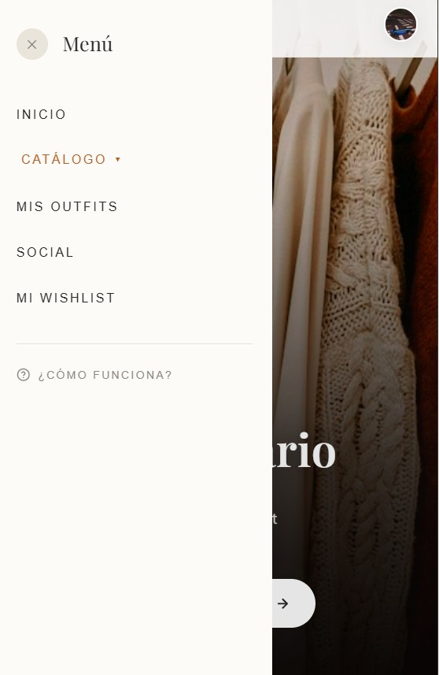

# Planells: Smart Wardrobe


A mobile-first web app to organise your clothes, build outfits and share them with friends. It installs on the phone like a native app.

## About the project

Personal project built with one collaborator between May and July 2026. It is a complete app, with authentication, a cloud database, image storage and a social layer, written with React and Firebase. About 7,500 lines of source code.

## Screenshots

<p align="center">
  
  &nbsp;&nbsp;&nbsp;
  
</p>

*Home screen and navigation menu: catalogue, outfits, social feed and wishlist.*

## Features

**Wardrobe**
- Add garments with photos, organised by category, with filters and a configurable set of active categories.
- Wishlist for items you want to buy.

**Outfits**
- Drag-and-drop outfit builder on a canvas, with custom touch gestures, layer controls and a trash area. Outfits can be saved.
- Daily calendar with a streak counter that is always recalculated from the real dates.
- Shareable image of an outfit (a photo plus the outfit sketch), generated in the browser.

**Social**
- Friend requests and friendships between users.
- View friends' outfits, with a "buy this look" link.
- Affiliate link support that is configured in a single file.

**Profile and settings**
- Profile with charts about colours, garments, brands and purchases.
- Light and dark theme, and custom wallpapers.
- Onboarding tutorial.

**Privacy**
- Privacy policy page.
- Full data export as a JSON file.
- Complete account deletion: photos, database records and the account itself.

**Installable**
- Web app manifest and service worker, so it can be added to the home screen in standalone mode.

## Tech stack

| Area | Technology |
|---|---|
| Front end | React 19, Vite |
| Authentication | Firebase Authentication with Google sign-in |
| Database | Cloud Firestore with real-time listeners and offline cache |
| File storage | Firebase Storage |
| Charts | Recharts |
| Tooling | ESLint, service worker, web app manifest |

## Project structure

```
src/
├── components/   Screens and modals (wardrobe, outfits, wishlist, profile...)
├── hooks/        Data and state logic (auth, garments, outfits, social, calendar...)
├── utils/        Outfit sharing, data export, account deletion, affiliate links
└── firebase.js   Firebase configuration
public/           Manifest, service worker, icons and privacy policy
```

## Design decisions

- **One custom hook per feature.** Authentication, garments, outfits, wishlist, social and calendar each have their own hook, which keeps the main component manageable.
- **Deterministic document IDs.** A friendship between two users and a calendar day for a user get an ID built from their keys, so duplicates cannot exist and saving is a simple upsert.
- **Derived streak.** The calendar streak is computed on the fly from real dates and never stored, so it cannot get stuck on an old value.
- **Instant first render.** The last theme and wallpaper are cached on the device, which avoids a flash of the default look while Firebase loads.

## Run it locally

```bash
npm install
npm run dev
```

The app needs a Firebase project with Authentication (Google), Firestore and Storage enabled. Put your own configuration in `src/firebase.js`.
